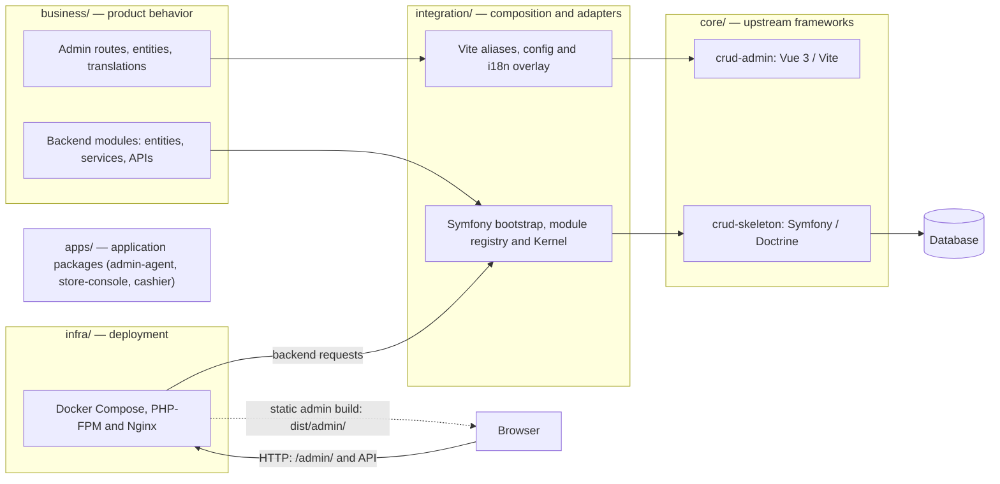

# ns-ultimate

Integrated application built from two upstream cores and project-owned business modules.

## Repository layout

- `core/crud-admin/` — Vue 3 admin frontend, tracked as a Git subtree of `immane/crud-admin`.
- `core/crud-skeleton/` — Symfony backend, tracked as a Git subtree of `immane/crud-skeleton`.
- `integration/` — project-owned application wiring and adapters between core and business modules.
- `business/` — all project-specific frontend and backend business functionality.
- `apps/` — self-contained application packages. `admin-agent/` is composed through integration and included in Docker and CI; `store-console/` and `cashier/` are built and tested independently.
- `docs/` — architecture, contracts, operations, and work records.
- `infra/` — project-owned deployment assets (Docker Compose, PHP-FPM/Nginx, MySQL/Redis topology).

Keep upstream code intact where possible. Put product behavior in `business/`, and keep `integration/` focused on registration and adaptation. If a reusable extension point is missing, make the smallest generic change in the relevant core and submit it upstream via a branch and PR.

See [docs/README.md](docs/README.md) for documentation, [the architecture guide](docs/design/architecture.md) before adding modules, and [the subtree workflow](docs/operations/core-sync.md) before updating a core.

## Local development

```sh
make install
make dev
```

On first run, `make dev` prompts for a loopback MySQL connection and admin identity, applies migrations, and creates the admin if absent; later runs start the backend and Vite without repeating setup. Use `make dev-reset` to reset the local development database and start over. For Docker PHP/MySQL, run `make docker-dev`; see [the development guide](docs/operations/development.md) for setup, reset, debugging, and checks.

## Quickstart and deployment

- [README.zh-cn.md](README.zh-cn.md) — 简体中文项目介绍与架构概览。
- [QUICKSTART.md](QUICKSTART.md) — install PHP 8.5, Composer 2, Node.js/npm, run the app, and execute tests.
- [QUICKSTART.zh-cn.md](QUICKSTART.zh-cn.md) — 简体中文快速开始。
- [DEPLOY.md](DEPLOY.md) — detailed non-Docker production deployment and `.env` configuration.
- [DEPLOY.zh-cn.md](DEPLOY.zh-cn.md) — 简体中文部署指南。
- [Docker Compose/Nginx foundation](infra/docker/README.md) — project-owned container build and service topology.
- [Docker Compose/Nginx 基础设施（简体中文）](infra/docker/README.zh-cn.md)
- [Local development and debugging](docs/operations/development.md) — env precedence, debugging, and validation reference.
- [CI workflow](.github/workflows/ci.yaml) — project workflow, assistant, admin composition, backend integration, PHPStan, composed admin build, and the independent store-console/cashier UI checks; upstream core test suites are intentionally excluded.

## Architecture



Business modules own domain behavior; integration owns only wiring. The admin and API are built from separate upstream cores and composed into one deployable application. In deployment, Nginx serves the composed admin build at `/admin/` and routes backend requests to the integration front controller. `apps/admin-agent/` is explicitly included in this composition, Docker context and tests. `apps/store-console/` and `apps/cashier/` are independent builds with their own UI checks and are not embedded in the composed admin/API deployment; other apps are not automatically discovered or deployed. See the [architecture guide](docs/design/architecture.md) and [system contracts](docs/contracts/README.md).

## Store operations

The Store business modules provide scoped employee APIs for catalog availability, order fulfillment and counter-session ordering. `apps/store-console/` is a separately built mobile staff workspace with live login, permission-based Kitchen/Cashier/Orders views, and an isolated demo-only customer payment entry.

Employees can view active counter sessions, update participant counts and notes, create additional orders, replace eligible unpaid orders and cancel eligible unpaid orders with an audited reason. Counter sessions open automatically when the first customer order is bound. Counter configuration, session management, ordering, replacement and cancellation use independent store-scoped permissions; job titles such as "Kitchen" and "Cashier" are frontend compositions, not backend roles. Checkout, real collection, refunds, financial reports and printing remain unimplemented, and order amounts are not payment results.

Register the capability roles with `app:store:seed-staff-authorization` and `app:counter:seed-authorization`, then assign only the needed grants through existing authorization management. The seeds create no users or assignments. See the [operations contract](docs/contracts/store-console-operations.md), [counter operations contract](docs/contracts/store-console-counter-operations.md) and [app guide](apps/store-console/README.md).

## Store Product fields

The Store Product admin form exposes `sortOrder`, `recommendationLevel`, and `isSoldout` as dedicated fields, plus a `settings` JSON object for `kitchenPrinterEnable`, `startSaleTime`, and `endSaleTime`. Display-only `subtitle` and the `cover` URL remain under `metadata`. Sale times are stored and validated as paired `HH:mm` values and enforced by the business pricing resolver for new quotes/orders, including overnight windows in the store timezone; sold-out state also blocks new quotes. The kitchen flag only participates in matching print rules and does not print by itself. The system metadata endpoint (`/system/entities/App/Store/Entity/Product`) includes the business extension fields and their backend translations while keeping the core Product entity name stable for Admin. See the [backend entity extension contract](docs/contracts/backend-entity-extension.md) for the integration and migration details.

## Project-owned code and upstream licenses

Project-owned code and documentation outside `core/` are licensed under the [MIT License](LICENSE), copyright Lam K. The upstream subtrees and third-party components remain under their respective licenses and notices.

The admin core is MIT-licensed. The backend core currently identifies itself as Apache-2.0 in its `LICENSE` and `composer.json`. Preserve each core's license and notices when redistributing it.
