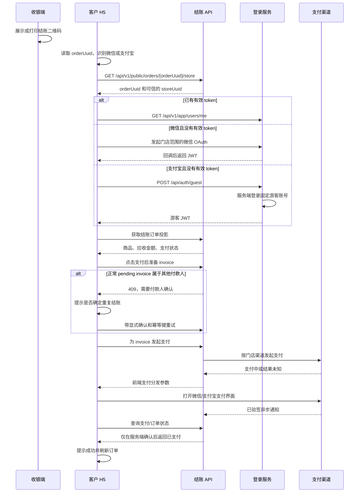

# H5 结账流程

**状态：设计方案，尚未全部实现。** 本文定义客户 H5 结账的目标流程，不表示文中每个接口或支付渠道都已经上线。当前缺口见[当前实现缺口](#11-当前实现缺口)。

## 1. 范围

收银端为一个已确认的交易订单生成结账二维码。客户扫码后，根据所在终端完成微信登录或支付宝固定游客账号自动登录，核对服务端返回的订单商品和应收金额，创建或复用 invoice，通过门店配置的支付渠道付款，最后以服务端确认的结果结束流程。

首期范围包括：

- 收银端展示或打印同一个结账二维码；
- 微信 H5 登录和支付宝固定游客账号自动登录；
- 只读的结账订单投影，包含商品明细和应收金额；
- invoice 的创建、复用、替换以及多用户并发结账保护；
- 微信 JSAPI 和门店配置的汇付支付分发；
- 服务端确认后的成功、处理中、失败状态；
- 支付完成后刷新订单状态。

退款、结账优惠、税务小票和打印机硬件接入不在本流程中。打印二维码可以使用浏览器打印或已有打印能力，但二维码内容和生命周期必须与屏幕展示的一致。

## 2. 入口 URL 和信任边界

现有门店控制台生成的入口为：

```text
https://<payment-host>/h5/payment/p.html?o=<orderUuid>
```

`orderUuid` 用于定位订单。登录前，H5 通过 `GET /api/v1/public/orders/{orderUuid}/store` 获取可信的门店上下文，入口 URL 不再携带 `storeUuid`。H5 不得向服务端提交可信的金额、币种、付款人、invoice 状态、支付凭证或商户身份。

当前 `/h5/payment/p.html` 入口从公开的订单门店接口和结账订单投影读取门店与账单信息，支付状态以服务端返回为准，不使用浏览器本地演示数据。

订单 UUID 只是标识，不是查看任意订单字段的授权凭证。结账页应使用独立的受限订单投影，不直接复用面向订单所有者的通用订单接口。投影不得返回客户身份、配送信息、员工信息、内部 metadata、成本、利润或任意订单 metadata。

后续可以给二维码增加短期签名结账 token，使二维码绑定到一个门店/订单并支持撤销。该 token 只能作为附加保护，不能替代服务端鉴权，也不能被视为支付凭证。

## 3. 端到端流程



浏览器里的“支付成功”回调只能作为提示。只有验签后的支付通知或主动查询对账结果，才能作为支付成功的权威依据。

## 4. 终端识别与登录

终端识别只用于选择登录和支付交互，不授予任何权限，也不能决定可信金额。

| 容器 | 判断提示 | 已有有效 token | token 缺失或过期 |
| --- | --- | --- | --- |
| 微信 | User-Agent 包含 `MicroMessenger` | `/api/v1/app/users/me` 成功后继续 | 进入门店范围的微信 OAuth |
| 支付宝 | User-Agent 包含 `AlipayClient` | `/api/v1/app/users/me` 成功后继续 | 调用固定游客账号自动登录接口 |
| 其他 | 两者都不包含 | 已认证且支付受支持时继续 | 提示请使用微信或支付宝扫码 |

微信扫码进入的是公众号 H5，不是小程序。登录必须使用当前门店配置的公众号 OAuth。回调只保留订单 UUID 并返回 `/h5/payment/p.html?o=<orderUuid>`，登录后再次通过公开的订单门店接口解析可信 `storeUuid`。服务端必须校验回调域名和返回路径，不能直接使用任意用户提交的 `redirect_uri`，否则会形成开放重定向风险。

支付宝终端不向 H5 暴露账号密码。H5 调用服务端自动登录接口，由服务端使用固定游客账号完成登录。建议契约为：

```http
POST /api/auth/guest
Content-Type: application/json

{"storeUuid":"...","orderUuid":"...","terminal":"alipay"}
```

返回结构与其他登录接口一致，包含 access token 和 refresh token。服务端必须解析已配置的固定游客主体，增加限流，避免收集无关个人信息，并且不能给游客赋予门店管理或员工权限。后端通过现有身份服务使用固定账号名 `游客` 登录；密码作为部署密钥配置，必须使用最新提供的固定游客密码，不得写入 H5 代码、接口响应、日志或本仓库。配置项为 `GUEST_LOGIN_IDENTIFIER=游客` 和 `GUEST_LOGIN_PASSWORD=<当前固定游客密码>`。

当前联调版本尚未部署独立游客登录接口，H5 直接调用现有 `POST /api/auth/login`，使用固定账号名 `游客` 和部署方提供的固定密码换取 token。该方式会让固定密码进入浏览器代码，仅适用于当前联调；正式上线前应改由服务端 `/api/auth/guest` 使用部署密钥登录，避免继续向客户端分发固定密码。

由于所有支付宝客户都登录为同一个固定账号，invoice 的 `payer` 无法区分两次支付宝扫码。判断“是否由当前用户发起”时还必须比较服务端为本次扫码订单签发的结账会话标识。该标识在加载订单时产生并记录到 invoice/支付尝试中；即使付款人相同，不同扫码会话也会得到不同标识。

JWT 不得出现在结账 URL、二维码、日志或统计事件中。token 过期返回 `401` 时，H5 清除旧 token，重新执行当前终端的登录，再加载同一个订单，不能把它当成新的结账。

## 5. 获取结账订单

加载支付投影前，H5 先解析订单所属门店：

```http
GET /api/v1/public/orders/{orderUuid}/store
```

响应只包含 `orderUuid` 和 `storeUuid`。该接口公开、只读，返回的订单和门店身份必须与请求的订单一致。

结账页使用公开的只读订单投影接口，不复用按订单所有者限制的 `GET /api/v1/app/orders/{id}`。门店收银台创建的订单可能是匿名订单，扫码后才登录的客户不一定是 Trade 订单的 `user`；公开接口按订单 UUID 定位订单，并只返回支付页所需的受限字段。

已上线读取契约：

```http
GET /api/v1/public/orders/{orderUuid}/payment
Authorization: 可选（公开只读，不用于支付授权）
```

响应只包含客户核对账单所需字段：

```json
{
  "code": 0,
  "message": "SUCCESS",
  "data": {
    "orderUuid": "...",
    "status": "confirmed",
    "store": { "uuid": "...", "name": "示例门店" },
    "currency": "CNY",
    "amount": 2400,
    "items": [
      {
        "name": "商品",
        "specification": "规格",
        "quantity": 2,
        "unitPrice": 1200,
        "amount": 2400
      }
    ],
    "provider": "huifu",
    "channels": ["jspay", "native"],
    "defaultChannel": "jspay",
    "invoice": null
  }
}
```

金额统一使用最小货币单位整数。门店信息由订单的可信生命周期数据解析，客户端不需要再用 `storeUuid` 指定查询范围。订单不存在、门店不可用或生命周期缺失统一返回 `404`；当前 invoice 来源、金额、币种等与订单不一致时返回 `409 order_payment_conflict`。接口只读，不得创建 invoice、支付尝试或返回客户身份、商品快照、额外 metadata 等非页面字段。

公开投影返回订单和当前 invoice 状态。H5 只有在 `status=confirmed`、invoice 不是终态且门店 `channels` 非空时展示支付按钮；已取消、已支付、已合并等状态展示对应结果，不继续创建 invoice。

H5 不得自行重新计算应收金额，也不能把各行小计相加后替代服务端金额。界面展示服务端订单快照；遇到版本冲突时刷新后重新展示。

## 6. 点击支付后的 invoice 处理

只有客户点击“支付”后才执行 invoice 处理。处理过程必须锁定订单行，并使用客户端生成的 `paymentRequestId` 作为幂等键。相同请求重试时返回相同结果，不能重复创建 invoice。

服务端按以下规则处理：

| 当前状态 | 处理结果 |
| --- | --- |
| 订单没有 invoice | 为当前订单和当前付款人创建 invoice |
| invoice 为 `pending`，属于当前用户，且来源、金额、币种都与订单一致 | 复用该 invoice |
| invoice 为 `pending`，属于其他用户或其他结账会话，客户尚未确认 | 返回 `409 INVOICE_PAYER_CONFLICT`，前端弹窗提示 |
| invoice 为 `pending`，属于其他用户或其他结账会话，客户已确认替换 | 为当前用户和当前结账会话创建新 invoice，并更新订单的 invoice 指针 |
| invoice 为 `failed` 或 `cancelled` | 创建新 invoice |
| invoice 行不存在，或来源、金额、币种与订单不一致 | 视为异常，创建新 invoice |
| invoice 为 `paying` | 不创建也不替换；查询并等待渠道结果 |
| invoice 为 `paid`、`partial_refunded` 或 `refunded` | 不再创建 invoice，展示已结算状态 |

`paying` 不能被当作可替换的“正常 invoice”。此时渠道请求可能已经发出，创建第二张 invoice 会增加重复扣款风险。H5 应进入等待状态并轮询，直到结果明确。

允许替换时，服务端必须在同一事务中关闭旧的、尚未提交渠道请求的 `pending` invoice，再把订单指向新 invoice。如果旧 invoice 已经开始任何渠道请求，替换必须失败并进入查询流程。这样可阻止之前扫码的人继续支付已被当前客户替换的 invoice。旧 invoice 记录必须保留，不能删除。

确认弹窗文案固定为：

```text
已经有其他人扫码结账，可能会重复结账，是否确定？
```

弹窗按钮为“确定”和“取消”。“取消”不发送支付请求，也不创建 invoice。“确定”时，前端携带明确确认标记和之前返回的 invoice 引用重试。后端必须重新检查全部状态；状态已变化时返回冲突，不能沿用旧判断。

建议请求：

```http
POST /api/v1/app/checkout/orders/{orderUuid}/invoice
Authorization: Bearer <token>
Content-Type: application/json

{
  "storeUuid": "...",
  "paymentRequestId": "...",
  "checkoutSessionId": "...",
  "confirmPayerReplacement": false,
  "expectedInvoiceUuid": null
}
```

响应返回 invoice UUID、状态、金额、币种，以及该 invoice 是否属于当前付款人和当前结账会话。不得返回渠道密钥或其他付款人的身份信息。使用固定支付宝账号时，必须依靠 `checkoutSessionId` 保留重复扫码提示；如果只比较 `payer`，所有支付宝客户都会被识别为同一个人。

## 7. 按门店扫码渠道分发支付

浏览器只选择终端和交互形式。服务端根据可信的门店配置、已确认订单和当前 invoice 选择支付供应商。客户端不能通过提交 `huifu`、`wechat` 等字段绕过门店已经关闭的支付渠道。

建议请求：

```http
POST /api/v1/app/checkout/orders/{orderUuid}/payments
Authorization: Bearer <token>
Content-Type: application/json

{
  "invoiceUuid": "...",
  "paymentRequestId": "...",
  "terminal": "wechat"
}
```

发起渠道请求前，服务端必须重新确认当前付款人、invoice 状态、金额、币种、订单状态、门店归属和门店支付渠道是否启用。渠道请求按 invoice 串行化，双击或多个标签页不能启动两个互不知情的渠道请求。

| 已配置渠道 | H5 终端 | 服务端分发 |
| --- | --- | --- |
| 汇付 | 微信 | 走门店范围内的 `huifu` 网关；`channel=jspay`，`tradeType=T_JSAPI`；服务端从门店配置的微信应用解析 OpenID |
| 汇付 | Native 二维码兜底 | `channel=native`，`tradeType=T_NATIVE`；返回渠道二维码内容 |
| 微信支付 | 微信 H5 | 走门店范围内的 `wechat` 网关，返回公众号 JSAPI 参数 |
| 支付宝或汇付支付宝流程 | 支付宝 | 只能走已配置且已验证的适配器；不能仅根据支付宝 User-Agent 放行 |

当前汇付模块已经有 `quickpay` 适配代码，但真实产品契约尚未验证；仓库也没有支付宝支付模块。支付宝支付必须在签名请求、回调、查询、金额和幂等对账都覆盖后才能启用。支付宝固定游客登录本身不等于支付宝支付已开通。

当前的 `POST /api/v1/store/{storeUuid}/huifu-payments` 是员工授权接口，客户 H5 不能直接调用。应新增客户结账 facade，在确认订单、门店、invoice 和当前客户关系后，通过服务端可信 proof 调用同一个门店支付服务。

后端返回与具体渠道无关的统一结构：

```json
{
  "invoiceUuid": "...",
  "status": "paying",
  "provider": "huifu",
  "action": "wechat_jsapi",
  "payInfo": {},
  "qrCode": null,
  "payUrl": null
}
```

微信 JSAPI 的 `payInfo` 交给微信桥接层使用。H5 不生成或签名商户请求。渠道二维码兜底时，H5 只把不透明的 `qrCode` 内容渲染成二维码，不能把它当作可信指令解析。

## 8. 支付结果、轮询和订单刷新

浏览器中的渠道成功回调只是提示。渠道界面返回后，H5 进入“支付中/查询中”，使用有上限的指数退避轮询结账订单；如果渠道适配器提供安全查询，也可以调用专门的支付查询接口。

只有服务端返回 invoice 已支付，或订单支付状态已支付时，H5 才能显示成功。后端通知处理必须幂等，并通过现有 invoice 监听器更新 Trade 订单。成功后显示提示，并刷新 H5 当前订单；收银端在下一次刷新时看到同样的已支付状态。

结果处理：

- `paid`：停止轮询，显示成功提示，刷新订单。
- `paying` 或 `unknown`：保持支付锁定，提示结果待确认，允许重新查询；不得创建新 invoice。
- `failed`：显示重试按钮。再次点击时重新执行 invoice 处理；旧 invoice 确认失败后才允许创建替代 invoice。
- `cancelled`：不得继续支付，刷新后返回账单页。

渠道结果未知时，服务端必须创建或保留支付尝试记录，支持后续查询对账，并在结果明确前阻止替换。浏览器成功回调不能直接把 invoice 标记为已支付。

## 9. UI 状态与失败处理

页面至少需要 `authenticating`、`loading-order`、`order-unavailable`、`payable`、`confirm-repeat-payment`、`creating-invoice`、`provider-pending`、`checking-result`、`paid`、`failed` 等明确状态。请求进行中和浏览器离线时必须禁用支付按钮。

登录跳转前后必须保留 `orderUuid` 和 `storeUuid`。客户提交的金额、invoice、渠道等字段不能作为可信状态跨页面保存。刷新页面后重新读取订单，并恢复已知的处理中状态。

错误码用于前端稳定地做多语言展示：

| 错误码 | HTTP | 用户处理 |
| --- | --- | --- |
| `ORDER_NOT_FOUND` | 404 | 提示结账链接无效或已过期 |
| `ORDER_NOT_PAYABLE` | 409 | 刷新并展示最新订单状态 |
| `ORDER_ALREADY_PAID` | 409 | 展示已支付，不再支付 |
| `INVOICE_PAYER_CONFLICT` | 409 | 展示重复结账确认弹窗 |
| `PAYMENT_IN_PROGRESS` | 409 | 展示查询中，不再创建 invoice |
| `PAYMENT_CHANNEL_UNAVAILABLE` | 409 | 提示联系门店工作人员 |
| `AUTH_REQUIRED` | 401 | 重新执行当前终端登录 |

## 10. 验收标准

- 收银端可以为已确认订单展示并打印同一个结账二维码。
- 微信在无有效 token 时进入门店范围 OAuth；支付宝在无有效 token 时由服务端自动登录固定游客账号；两种流程都不会把登录凭据放进 URL。
- 客户只能读取扫码订单与门店对应的受限商品/金额投影。
- 没有 invoice 时创建；同一付款人的有效 pending invoice 复用；异常 invoice 被替换。
- 其他付款人的 pending invoice 会触发指定提示。确认后创建受控替代 invoice；取消时不创建、不支付。
- 并发请求、双击和 invoice 状态变化不会静默创建两张可支付 invoice，也不会启动两个渠道请求。
- 汇付和微信支付使用门店配置及服务端解析的付款人身份；不信任客户端的渠道参数。
- 只有服务端确认后才显示成功，并刷新订单。
- 结果未知时保持可查询，不因浏览器回调变成成功，也不因此新建支付。

## 11. 当前实现缺口

仓库目前已经具备结账 URL 生成器、门店控制台二维码界面、门店范围微信登录、invoice/支付基础、门店微信支付网关，以及汇付 JSAPI/Native 网关。要把本设计称为已实现，还需要：

- 公开订单投影已经上线，H5 支付页已改为按订单 UUID 调用该接口；
- 新增客户结账模块/facade，承载受限订单读取、invoice 处理、支付分发和状态轮询；
- 新增支付宝固定游客账号的服务端自动登录接口，并把密码保存在部署密钥配置中；
- 新增并验证支付宝或汇付支付宝支付适配器；
- 把结账二维码打印按钮接入真实打印流程；
- 上线前补充真实渠道、回调、对账和 MySQL 并发验收测试。

